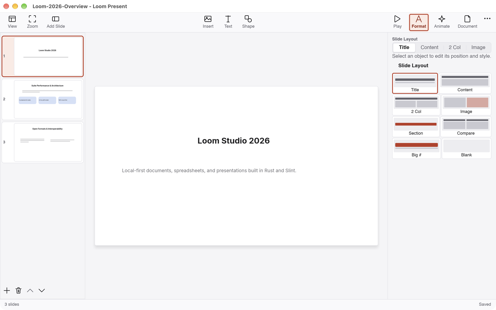

# Loom

Loom is an original, local-first creative software suite built with Rust and Slint.

The v1 scope on `main` is three desktop applications. Their acceptance status is in the [current-truth section](docs/workflow/current.md#current-truth).

- [**Loom Writer**](loom-writer/README.md) — Document composition with structured inspectors, rich typography, image text wrapping, inline hyperlinks, Format Painter, tables, lists, headers/footers, footnotes, comments, tracked changes, Outline Navigator, Print Preview, and DOCX/PDF/Markdown export.
- [**Loom Sheets**](loom-sheets/README.md) — Analytical spreadsheet with multi-sheet workbooks, 2,000+ Excel-compatible formulas, smart series auto-fill, freeze panes & row/column hiding, Format Painter, formula auditing, conditional formatting, data tools, pivot tables, charts, and full OOXML XLSX/CSV/PDF export.
- [**Loom Present**](loom-present/README.md) — Presentation design with categorized theme chooser, slide navigator & full-window Slide Sorter, element effects, grouping/locking/flip, build animations, speaker notes, presenter view with annotations & jump-to-slide, and PPTX/PDF export.

## Visual showcase

| Application | Light Theme | Dark Theme |
|---|---|---|
| [**Loom Sheets**](loom-sheets/README.md) |  |  |
| [**Loom Writer**](loom-writer/README.md) |  |  |
| [**Loom Present**](loom-present/README.md) |  |  |

Shared workspaces provide package formats, document and text engines, recovery, native desktop adapters (file dialogs, macOS & Linux global menu bars), UI components, and interoperability foundations for these applications. The other five applications (Photo, Motion, Video, Studio, Encode) are locked and kept on the `apps/later` branch.

## Current status

- **Active phase:** `office-v1` — the shared `loom-ui` foundation is `ACCEPTED`; **Loom Sheets**, **Loom Writer**, and **Loom Present** are `IN_PROGRESS` (`ACCEPTANCE_BLOCKED` pending final acceptance gates). The five later applications (`Photo`, `Motion`, `Video`, `Studio`, `Encode`) remain `LOCKED` on `apps/later`.
- **Single live authority:** The [current-truth section](docs/workflow/current.md#current-truth) owns the live gate and application quality/work table. Engineering rules, architecture contracts, and evidence gates are routed by [`AGENTS.md`](AGENTS.md) to [docs](docs/README.md), and the dated parity audit lives in [docs/audits/uiux-2026-10-27.md](docs/audits/uiux-2026-10-27.md#iwork--microsoft-office-p0-parity-audit--implementation--2026-11-25).
- **Shipped on `main` (PRs #30–#34):**
  - **Visual polish & themes:** Wave 1/2 `loom-ui` polish with Light, Dark, and High-Contrast themes, per-app accents (Sheets jade, Writer violet, Present coral), and 47 verified macOS screenshots.
  - **Native desktop services:** Shared native file dialogs, crash recovery, and platform global menu bar reflection (`MenuBarService`) supporting macOS AppKit `NSMenu` and Linux DBusMenu (`com.canonical.dbusmenu`).
  - **Shared `loom-core` & app P0/P1 parity:** `ImageWrap`, `Hyperlink`, `StyleClipboard`, rich HTML clipboard, and Wave 2 deep-wiring across Writer, Sheets, and Present.
- **Latest verified checkpoint (2026-11-25 macOS audit):** 3,610+ passing Rust tests across all 4 workspaces with strict Clippy (`-D warnings`), plus all 4 repository audits and 58 Python governance/foundation unit tests passing. Dated comparative parity estimates (not v1 acceptance approval): **Loom Sheets** 8.8/10 vs Apple Numbers (7.9/10 vs Excel), **Loom Writer** 8.8/10 vs Apple Pages (8.0/10 vs Word), **Loom Present** 8.6/10 vs Apple Keynote (8.1/10 vs PowerPoint).
- **Remaining gates (`ACCEPTANCE_BLOCKED`):** Final-tree Linux and Windows verification re-runs, `PERF-01` native scroll/edit/reprojection and whole-app RSS budgets (plus Writer `100p` recovery margin), Gate 9 spoken screen-reader verification, and bare-metal GPU/Wayland/fractional-DPI frame timings.
- All current work integrates on `main`.

## Reusable interaction tooling

- [Linux desktop input skill](.agents/skills/linux-desktop-input/SKILL.md) — guarded mouse and keyboard interaction for Linux desktop QA when native computer-use controls are unavailable.

## Build and test

The umbrella scripts live under `loom-bootstrap/scripts/`. Each application and shared subsystem is an independent Cargo workspace and can also be built from its own directory.

Typical validation for one workspace:

```bash
cargo fmt --all --check
cargo clippy --workspace --all-targets --all-features -- -D warnings
cargo test --workspace
cargo build --workspace --release
```

The CI matrix additionally validates Linux x86-64, Windows x86-64, macOS arm64, and macOS x86-64 builds (macOS x86-64 is being retired: macOS 27 dropped Intel Macs and GitHub retires its Intel runner in fall 2027; see [AGENTS.md §18](docs/rules/platforms.md#18-2027-readiness-baseline--platforms-accessibility-supply-chain-and-regulation)), native packages, functional journeys, keyboard palette journeys, UI productisation audits, and visual QA evidence.

## Engineering discipline

Loom prefers **proven libraries with small adapters** over unnecessary engine rewrites. Compatibility is established with real Writer/Sheets/Present files across the complete native GUI workflow—import, edit, save, reopen, export and failure/recovery—not by startup or fixture-only tests. Repeatable performance measurements include input latency, p50/p95, peak memory, hardware/OS, actual file workload and failures. Imported source, libraries, models, fonts and assets need component-level provenance and license review.

AI-agent changes must preserve the current serial workflow gate and report independently tested evidence and unrun checks. SLOPOS and PARAMA integration remain future, separate milestones. See [AGENTS.md §16](docs/rules/engineering.md#16-engineering-discipline--reuse-interoperability-and-real-workflow-evidence).

## Edge efficiency goal

Loom aims for **responsive small-document workflows on a Raspberry Pi Zero 2 W** (AArch64 Cortex-A53, **512 MB RAM**) as a future low-end reference, while preserving fully featured workloads on capable systems. The GUI must stay interactive and allow progress/cancellation during slow disk/network/CPU work; large documents and demanding media/ML may require more memory and must fail safely with truthful explanations, never silently drop data. Memory, input p95, caches, startup and swapping must be instrumented on **actual hardware**.

**AArch64 Pi Zero 2 W support is not implemented or verified.** Existing Rust/Slint, supported host-platform gates and sequential app development remain unchanged. See [AGENTS.md §17](docs/rules/platforms.md#17-edge-first-efficiency-raspberry-pi-zero-2-w-reference).

## Principles

- Local-first and offline-capable core workflows.
- No mandatory account, telemetry, advertising, or hidden uploads.
- Versioned, inspectable Loom project formats.
- Original Loom visual identity and design system.
- Incomplete features remain visible rather than being represented as finished.
